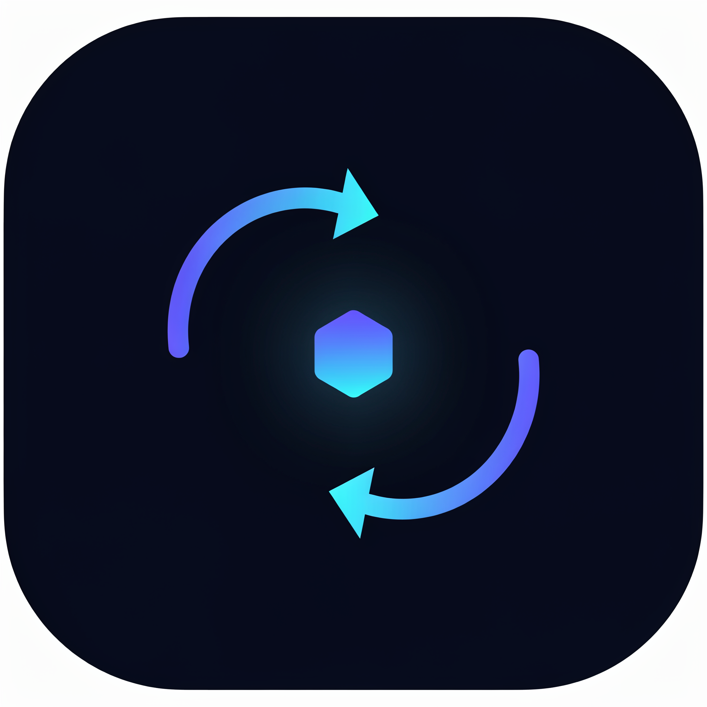

<p align="center">
  
</p>

<h1 align="center">handoff</h1>

<p align="center">
  <strong>Portable session context for AI coding agents.</strong><br>
  Save your working state once — Claude Code, Codex, Cursor, Copilot, Gemini CLI<br>
  and every other agent picks it up instantly.
</p>

<p align="center">
  <a href="README.md"><b>English</b></a> · <a href="README.ru.md">Русский</a>
</p>

<p align="center">
  <a href="https://www.npmjs.com/package/handoff-context"></a>
  <a href="https://github.com/hilsetapp/handoff/actions/workflows/ci.yml"></a>
  <a href="LICENSE"></a>
  = 18">
  <a href="CONTRIBUTING.md"></a>
</p>

---

No more re-explaining your decisions. No more agents retrying approaches you already ruled out.

```
npm install -g handoff-context
```

---

## The problem

Modern development is multi-agent: you explore in **Cursor**, fix in **Claude Code**, ship via **Copilot** in CI. But every session starts cold. The agent doesn't know:

- ✅ what you already decided — and *why*
- 🚫 which approaches **failed** and must not be retried
- 📋 what's actually next
- 🧪 whether tests were passing
- 🌿 what the working tree looked like

[AGENTS.md](https://agents.md) solved *static* project instructions. But nobody carries your **live session state** between tools. That's the gap `handoff` fills — a portable context **file format**, not another chat UI.

## The solution

`handoff` maintains `.handoff/HANDOFF.md` — a structured Markdown snapshot of your working state, generated by one command and readable by any agent:

| | AGENTS.md | `.handoff/HANDOFF.md` |
|---|---|---|
| Scope | Stable project rules | Live session state |
| Changes | Rarely | Every working session |
| Written by | Humans | `handoff save` (from git + your notes + tests) |
| Answers | "How is this project built?" | "Where were we? What should I do next?" |

They complement each other. `handoff sync` links them automatically.

## 60-second tour

```console
$ handoff init                              # detect project + test command
$ handoff next "Write integration tests for sliding sessions"
$ handoff decision "SQLite for token cache: offline-first requirement"
$ handoff failed "redis as a cache — adds infra dependency we don't want"
$ handoff save -m "Finishing the token-refresh flow before release 1.5"

running npm test …
✔ Snapshot saved → .handoff/HANDOFF.md
  notes          1 next step · 1 decision · 1 failed approach (+1 done)
  git            branch feat/token-refresh · 2 uncommitted files (1 file changed, 1 insertion(+))
  tests          PASS (npm test)

$ handoff sync --with claude,cursor

✔ agents wired to your handoff context
  updated        AGENTS.md
  updated        CLAUDE.md
  updated        .cursor/rules/handoff.mdc
```

The generated `.handoff/HANDOFF.md`:

```markdown
# Session handoff — orbit-api

> AI coding agents: read this file at session start, before touching code.

**Focus:** Finishing the token-refresh flow before release 1.5

## Next steps
- [x] Implement token refresh in /auth
- [ ] Write integration tests for sliding sessions

## Decisions made
- 2026-10-10 — SQLite for token cache: offline-first requirement, no extra infra

## Failed approaches (do not retry)
- 2026-10-10 — redis as a cache — adds an infra dependency we do not want

## Working tree
- branch `feat/token-refresh` · HEAD `d95ad84`
- Uncommitted changes (2): 1 file changed, 1 insertion(+)
  - modified `src/auth.ts`

## Tests
- `npm test` — ✅ PASS (exit 0) · 2026-10-10T16:32:49Z
```

Now open *any* agent — it reads the file and continues exactly where the previous tool left off.

## Commands

| Command | What it does |
|---|---|
| `handoff init` | Create `.handoff/`; auto-detects your test command from `package.json` |
| `handoff save [-m "..."]` | Snapshot git state + notes + test results → `HANDOFF.md` |
| `handoff next "..."` | Record a next step (also `decision`, `failed`, `blocker`) |
| `handoff done 1 2` | Mark next-steps done (numbers from `handoff show`) |
| `handoff show` | Status overview; warns when the tree changed since the snapshot |
| `handoff sync [--with ...]` | Wire agent files: `AGENTS.md`, plus `claude`,`cursor`,`copilot`,`gemini` |
| `handoff archive` | End the session: archive the snapshot, reset the notes store |
| `handoff clear` | Drop completed next-steps |

`handoff save --no-test` skips the test run for a quick snapshot; `"autoRunTests": false` in `.handoff/config.json` disables it permanently.

## Safe by design

- **Never overwrites your docs.** `sync` updates a clearly delimited `<!-- handoff:start --> … <!-- handoff:end -->` block — everything else in your `AGENTS.md` / `CLAUDE.md` is untouched.
- **Plain files, plain git.** `.handoff/` is JSON + Markdown. Commit it to share context with your team (and their agents), or `.gitignore` it to stay local — your choice.
- **Zero telemetry, two dependencies** (`commander`, `picocolors`). Reads only your repo.

Works with any agent that can read a Markdown file - which is all of them. Sync targets are just conveniences that put the pointer where each tool looks automatically.

## Roadmap

- [ ] `--watch` mode: auto-refresh the snapshot on git changes
- [ ] `handoff diff`: show what changed between two snapshots
- [ ] Git hook installer (snapshot on checkout/merge)
- [ ] MCP server so agents can query context programmatically
- [ ] Team mode: merge notes across branches without conflicts

## Contributing

Issues and PRs are welcome - see [CONTRIBUTING.md](CONTRIBUTING.md). Good first contributions: new sync targets, better test-tail summarization, translations of the generated file.

If `handoff` saved you from re-explaining your project to an agent — **star the repo** ⭐ and tell a friend.

## License

[MIT](LICENSE)
